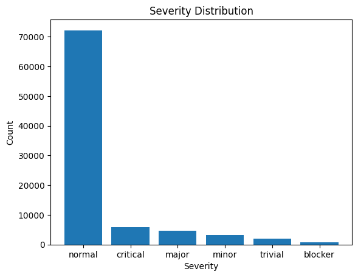
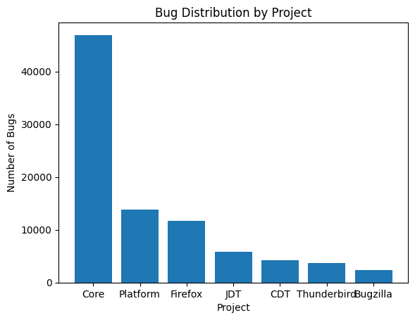
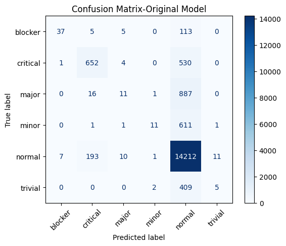

# 🐛 AI-Powered Software Bug Severity Prediction System

**Machine Learning · Natural Language Processing · Software Engineering**

A machine learning project that predicts software bug severity from bug descriptions and project information. Developed as part of the **Software Persona Artificial Intelligence Program**.

**Author:** Süleyman Bektaş  
**University:** Near East University · Software Engineering  
**Instructor:** Tahsin Soyak

## Project Overview

Software teams need to prioritize bug reports efficiently. This project investigates how NLP and machine learning can help predict one of six severity labels: **blocker, critical, major, normal, minor, trivial**.

## Dataset

The project analyzes **88,682 bug reports** across seven projects. The dataset is imbalanced: **81.38%** of reports have the **normal** label.

| Property | Value |
|---|---|
| Reports | 88,682 |
| Projects | 7 |
| Severity classes | 6 |
| Training samples | 70,945 |
| Test samples | 17,737 |
| Input features | Project; Short Description |
| Target | Severity Label |

## Technologies

Python · Google Colab · Pandas · NumPy · Matplotlib · Seaborn · Scikit-learn · TF-IDF · Logistic Regression

## Workflow

1. Explore and visualize the dataset.
2. Select predictive columns and clean the data.
3. Create **5,000 TF-IDF text features** and **7 one-hot project features**.
4. Use an **80/20 stratified train/test split**.
5. Train standard and class-weighted Logistic Regression models.
6. Compare classification metrics and inspect the confusion matrix.
7. Predict severity for new reports through an interactive notebook interface.

## Model Results

| Metric | Standard Logistic Regression | Balanced Logistic Regression |
|---|---:|---:|
| Accuracy | **84.16%** | 47.12% |
| Macro F1 | **33.13%** | 30.53% |

The standard model achieves higher accuracy and macro F1, but its performance is heavily influenced by the majority **normal** class. The balanced model improves recall for several rare classes at the expense of overall accuracy. **Accuracy alone is not sufficient for assessing severity classification.**

## Example Predictions

| Project | New bug report | Predicted severity |
|---|---|---|
| Core | Application crashes immediately after startup | Critical |
| Firefox | Browser freezes when opening multiple tabs | Normal |
| Platform | Minor spelling mistake in settings menu | Normal |

These are model predictions, **not verified ground-truth labels**.

## Visualizations

The notebook includes severity and project distributions, project-level severity analysis, and a confusion matrix.

### Severity Distribution

### Project Distribution

### Confusion Matrix

## Run the Notebook

1. Open [`AI_Bug_Severity_Prediction.ipynb`](AI_Bug_Severity_Prediction.ipynb) in Google Colab.
2. Obtain a dataset copy that you are permitted to use.
3. Upload the dataset to your Google Drive.
4. Update the notebook's `software_bugs.csv` path to your own file location.
5. Run the cells in order.

**Dataset note:** The CSV file is not included in this repository. The notebook currently references a Google Drive path and will require updating for other users.

## Limitations and Future Work

The dataset's class imbalance limits minority-severity predictions. Future work could test additional classifiers, richer text representations, resampling strategies, and a web-based interface.

---

**Süleyman Bektaş** · Near East University · Software Engineering
